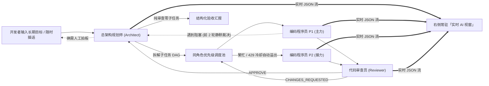

<div align="center">

# 轻舟 · AgyConductor

**轻量级原生多模型自动研发协同台**  
让「总架构师 · 编码程序员 · 代码审查员」在本地组成你的全自动 AI 研发团队

[](./LICENSE)
[](./Cargo.toml)
[-1d4ed8.svg)](#快速开始)
[](./CONTRIBUTING.md)

</div>

---

## 项目简介

在使用命令行 AI 编程工具处理复杂工程任务时，开发者往往会遇到几个典型痛点：

1. **单模型既当运动员又当裁判**：长周期任务容易出现上下文膨胀、偷懒漏改或自说自话宣布完工；
2. **配额限流与瞬时故障打断心流**：半夜跑大型重构时遇到 `429` 限流、`503` 账号池耗尽或网关波动就直接停摆；
3. **黑盒无感或终端窗口爆炸**：后台跑多角色时看不到 AI 正在干什么，或者同时弹出多个黑底命令行窗口难以管理；
4. **Electron 套壳臃肿**：只想要一个清爽的本地编排器，不想为此常驻几百 MB 的浏览器内核。

**轻舟（AgyConductor）** 采用 **Rust + `tao` + `wry`（系统原生 WebView2）** 构建，单文件编译产物仅 **~4.5 MB**，零重型前端框架依赖。它将本地 AI CLI 组织为 **总架构规划师（Architect）→ 编码程序员（Coder）→ 代码审查员（Reviewer）** 的闭环流水线，像带一支真实研发小队一样自动完成任务拆解、并行开发、独立代码审查、返工修复与最终验收汇报。

---

## 核心特性

### 1. 三角色闭环自动协同与主备/并行池调度
- **总架构规划师（Architect）**：快速勘察仓库结构，拆解具备明确验收标准与目标文件边界的子任务清单；对于纯代码审查或架构咨询类目标，支持零子任务直出结构化结论报告。
- **编码程序员（Coder）**：支持为同一角色挂载多个不同模型槽位（`P1` / `P2` ...），可选 **「优先级主备接力」** 或 **「优先级优先 + 并行溢出」** 策略；主力模型繁忙、连续异常或触发 `429/503` 冷却时，备用模型自动无缝接力。
- **代码审查员（Reviewer）**：独立校验编码结果，输出放行（`APPROVE`）或打回修改意见（`CHANGES_REQUESTED`），驱动编码员定向返工直至全部达标。

### 2. 右侧常驻独立「实时 AI 视窗」与终端无缝接管
- **默认自动跟随正在干活的 AI**：主界面右侧常驻独立深色实时流视窗，自动追踪当前处于 `Working` 状态的角色，实时流式呈现 `Thinking`（思考）、`ToolCall`（工具调用）、`Output`（标准输出）、`Stderr`（异常告警）与 `Result`（单轮汇总）。
- **一键手动锁定观察**：点击视窗顶部的任意角色胶囊即可锁定查看指定角色，不被并行角色抢走焦点；再次点击或点按「恢复自动」即刻切回自动跟随，右上角 `⤢` 支持一键展开大号终端抽屉。
- **外部终端交互接管 + MCP 群聊桥接**：任意槽位支持一键拉起外部 Windows Terminal / PowerShell 实时 `tail` 追踪，或直接 `--resume` 交互式接管该角色会话，并通过内置 `mcp-stdio` 服务在终端内读写协同群聊与任务板。

### 3. 二级阻塞静默裁决 + 人类随时插话（`@角色`）
- **一级技术分歧自动消解**：编码员或审查员上报阻塞时，优先交由总架构师在后台静默分析与重排（最多自动仲裁 2 轮），避免琐碎工程细节频繁打断用户。
- **二级升级置顶提醒**：仅当问题确需人类业务拍板、同一任务第 3 次卡住或超出最大返工轮数时，才触发系统提示音、任务栏闪烁与通俗中文决策卡片。
- **运行中无损插话**：协同运行期间可随时在底部输入框补充指导意见或 `@某个角色`，当前轮次一结束即优先唤醒总架构师动态调整后续计划。

### 4. Gateway 网关与官方双通道自适应（含通配符型号自愈）
- 自动探测本机 `agy` 官方可执行文件与 Gateway 启动器（`launch.mjs`），支持一键在线检查与升级 CLI。
- **网关通配符（`*`）自动展开与隔离注入**：针对上游中转网关返回 `models/gemini-4-carbon*`、`gemini-4-neon*` 等通配符型号的场景，自动展开为具体推理档位（`-xhigh` / `-high` / `-medium` / `-low`），并在 Conductor 专属目录动态合成会话级 `--settings`（严格保持用户原始 `~/.gemini/antigravity-cli/settings.json` **100% 只读零修改**）。

### 5. 多 CLI 中枢与本地离线用量统计看板
- **四大 CLI 侧边导航坞**：内置 **Antigravity (`agy`)**、**Codex**、**Claude Code**、**OpenCode** 本机安装状态与版本号探测，支持一键拉起各 CLI 交互式项目终端。
- **纯本地增量账单分析**：参考并升级 `cc-switch` 用量统计体验，纯离线只读扫描四大 CLI 本地历史日志与 SQLite 记录（内置基于系统 `winsqlite3.dll` 的零外部依赖只读查询与 `(mtime, size)` 增量磁盘缓存），提供：
  - 今日 / 本周 / 30 天 Token（输入、输出、思考、缓存命中）与官方美元成本估算；
  - 24 小时 / 7 天 / 30 天堆叠趋势柱状图、CLI 渠道占比环图与按模型聚合的计费明细表。

### 6. 项目历史记忆沿用、编队预设与进程树安全守护
- **智能沿用历史角色会话**：切换本地项目目录时自动检索过往会话，通过尾部健康度检测自动过滤上下文过满或异常未收敛的脏会话。
- **多套编队预设保存与秒切**：支持将常用的“极速日常组 / 深度架构组 / 审查专家组”保存为命名预设。
- **Windows Job Object 强守护**：所有子进程统一纳入 `JOB_OBJECT_LIMIT_KILL_ON_JOB_CLOSE` 作业对象，关闭窗口、暂停或删除槽位时精准回收对应进程树，杜绝后台孤儿进程。

---

## 协同工作流架构



---

## 快速开始

### 环境要求
- **操作系统**：Windows 10 / Windows 11（系统自带 Microsoft Edge WebView2 Runtime）
- **编译环境**：[Rust](https://rustup.rs/) `1.78+`（推荐 `x86_64-pc-windows-msvc` 工具链）
- **CLI 运行时**：本机已安装并登录 `agy`（Antigravity CLI，支持官方模式或本地 Gateway 模式）；安装 Codex / Claude Code / OpenCode 后可在左侧导航坞与用量看板中自动识别。

### 源码克隆与编译运行

```powershell
# 1. 克隆仓库
git clone https://github.com/lingxiao69/agy-conductor.git
cd agy-conductor

# 2. 开发模式直接运行
cargo run

# 3. 编译体积优化的 Release 原生单文件程序
cargo build --release --bin agy-conductor
# 产物路径: target\release\agy-conductor.exe
```

### 命令行辅助子命令

除了双击启动桌面协同台外，`agy-conductor` 还内置两个实用命令行入口：

```powershell
# 环境与模型列表自检（输出 JSON：运行时类型、版本号、展开后的可用模型与默认编队）
.\target\release\agy-conductor.exe --probe

# 供外部交互式 CLI 挂载的 MCP Stdio 桥接服务（由桌面端拉起接管终端时自动注入）
.\target\release\agy-conductor.exe mcp-stdio --room <房间快照目录> --alias <角色别名>
```

---

## 目录结构导览

全仓遵循严格的高内聚模块化设计（所有源码、前端模块与测试文件均保持 `< 500` 行）：

```text
agy-conductor/
├── assets/                     # 原生嵌入式前端资源（编译期内联进单文件二进制）
│   ├── index.html              # 主工作台骨架（东方极简宣纸暖白 + 右侧深色实时视窗）
│   ├── js/                     # 14 个原生 ES Modules（编队、群聊、右侧实时视窗、统计图表等）
│   └── styles/                 # 10 个按职责拆分的 CSS 样式表与设计 Token
├── src/
│   ├── main.rs / app_window.rs # 程序入口、CLI 子命令路由与 tao + wry 原生窗口宿主
│   ├── orchestrator/           # 多角色协同状态机、优先级/溢出调度池、二级阻塞仲裁与提示词契约
│   ├── agy/                    # agy 运行时探测、流式 JSON 解析、网关通配符展开、外部终端与自更新
│   ├── cli_hub/                # agy / Codex / Claude Code / OpenCode 多 CLI 探测与终端快启
│   ├── billing/                # 官方与 cc-switch 校准的模型单价目录及槽位实时费用计算
│   ├── usage_stats/            # 四大 CLI 本地日志离线增量聚合、只读 SQLite 解析与磁盘缓存
│   ├── storage/                # 原子文件持久化、历史群聊房间、编队预设与本地会话健康度扫描
│   ├── mcp_bridge/             # 标准 JSON-RPC 2.0 MCP Stdio 服务端（支持外部终端读写群聊板）
│   ├── ipc/                    # 前后端异步消息分发与 UI 状态快照同步
│   └── win_guard/              # Windows Job Object 进程树绑定与原生置顶通知守护
└── tests/                      # 覆盖调度闭环、通配符自愈、插话防死锁、计费与增量统计的集成测试集
```

---

## 本地数据存储与隐私安全

轻舟 AgyConductor 坚持 **Local-First（本地优先）** 原则：

- 应用自身配置、编队预设、历史协同房间记录（`board.jsonl` / `live.log`）与增量统计缓存统一保存在 `%LOCALAPPDATA%\AgyConductor\`；
- 对用户本机现有的 `~/.gemini/antigravity-cli`、`~/.codex`、`~/.claude` 与 OpenCode 本地数据目录**全程严格只读，绝不篡改任何原始配置文件**；
- **零遥测、零云端上传**：除调用你本机已配置的 CLI 工具本身外，AgyConductor 不向任何第三方服务器发送代码、提示词或统计数据。

---

## 开源共建路线图 (Roadmap)

本项目完全开源，非常欢迎大家提 Issue、讨论想法或直接提交 PR 一起把它打磨得更强大：

- [ ] **多 CLI 跨引擎混合编队**：将 Codex、Claude Code、OpenCode 正式接入后台无头协同引擎（例如：Claude 担任总架构师 + Neon / Codex 并行编码 + 异构模型交叉代码审查）
- [ ] **macOS 与 Linux 原生跨平台支持**：抽象进程组生命周期守护（`win_guard`）与外部终端拉起脚本（iTerm2 / Terminal.app / GNOME Terminal / tmux）
- [ ] **Git Worktree 级多编码员物理隔离**：并行开发互不干扰，审查通过后自动合并分支并辅助消解冲突
- [ ] **可定制角色 Prompt 模板与自定义单价表**：支持在 UI 中按团队规范微调架构师/审查员纪律及私有中转倍率
- [ ] **远程无人值守通知集成**：任务完工或触发二级人工拍板时，支持通过飞书 / 钉钉 / 企业微信 / Telegram Webhook 推送提醒

如果你准备参与代码贡献，请先阅读 [CONTRIBUTING.md](./CONTRIBUTING.md)。

---

## 致谢与开源协议

- 本地多 CLI 离线计费口径部分参考了优秀的开源项目 [cc-switch](https://github.com/farion1231/cc-switch)。
- 本项目基于 [MIT License](./LICENSE) 开源发布，欢迎自由使用、Fork 与共建。
